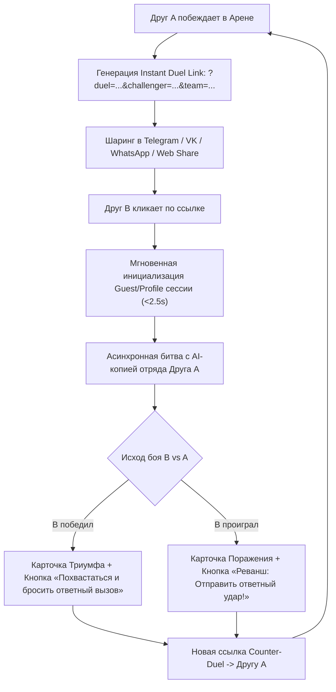
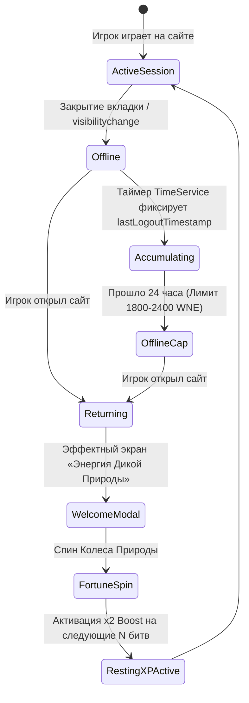

# ⚔️ MASTERS OF THE WILD — СПЕЦИФИКАЦИЯ ВИРАЛЬНЫХ МЕХАНИК И ВЕБ-АРХИТЕКТУРЫ
**Версия:** 1.0 (2026-10-25)  
**Роли:** Game Architect & Viral Mechanics Director  
**Проект:** [Masters of the Wild](file:///b:/Masters%20of%20the%20Wild/) (`mastersofthewild.ru`)  
**Стек:** TypeScript, PixiJS v8, GSAP, Howler.js, Zustand, Framer Motion, Tailwind CSS

---

## 1. АРХИТЕКТУРА ВИРАЛЬНОГО РОСТА (VIRAL LOOP ENGINE)

Традиционные веб-игры теряют до 85% входящего трафика на этапе принудительной авторизации, загрузки тяжелых ресурсов и отсутствия мгновенной игровой отдачи (Time-To-Play > 15s).

В *Masters of the Wild* виральная воронка проектируется вокруг **K-фактора > 1.25** за счет трех законов:
1. **Zero-Friction Duel Link (TTF < 2.5s)**: клик по ссылке друга сразу бросает игрока в тактический бой без форм регистрации.
2. **Revenge Hook («Отправить ответный удар!»)**: проигрыш или победа мгновенно генерируют персонализированный вызов-реванш.
3. **Visceral Tactility (3D Parallax & Howls)**: веб-кодекс зверей ощущается как премиальная коллекционная карточная игра (Hearthstone / Magic Arena) с живым откликом гироскопа и саунд-дизайном.



---

## 2. СИСТЕМА ДУЭЛЕЙ И ВЫЗОВОВ (INSTANT DUEL LINK)

### 2.1 Спецификация URL-схемы и Компактного Кодирования

Стандартные JSON-строки в query-параметрах превышают лимиты мессенджеров, подвержены обрезке превью в Telegram/VK и выглядят подозрительно для пользователей.  
Используется компактная схема Base64URL с контрольной суммой (CRC32/FNV-1a).

#### Формат URL:
```text
https://mastersofthewild.ru/?duel=<seed>&challenger=<id>&team=<comp>&sig=<checksum>&v=1
```

- `seed` (uint32 hex): 8-значный сид детерминированного генератора псевдослучайных чисел (PRNG Mulberry32) для воспроизведения боя. Пример: `a4f19b02`.
- `challenger` (string): Идентификатор игрока (`u_98412` или хэш анонимного профиля).
- `team` (compact encoded string): Сжатый бинарный кортеж параметров отряда.
- `sig` (hex4): 4-символьная контрольная сумма данных против подделки статов в URL.
- `v` (uint8): Версия формата сериализации (обратная совместимость).

#### Схема упаковки отряда (`team`):
Для героя и его экипировки создается компактный строковый токен:
```text
Format: <heroIndex>.<lvl>.<wArchetype>.<iLevel>.<skinId>.<perkMask>
Пример: 3.45.1.8.0.12
```
- `heroIndex`: `0` = panda, `1` = raccoon, `2` = minotaur, `3` = tiger_warrior, `4` = lion_knight.
- `lvl`: уровень героя (1–60).
- `wArchetype`: `0` = SWORD, `1` = BOW, `2` = STAFF, `3` = DAGGER.
- `iLevel`: средний уровень экипировки (avgItemLevel, 1–10).
- `skinId`: индекс скина (0–9).
- `perkMask`: битовая маска активированных рун и талантов (0–255).

Строка сжимается через URL-Safe Base64:
```typescript
export interface IDuelPayload {
    seed: number;
    challengerId: string;
    challengerName: string;
    heroId: string;
    level: number;
    weaponArchetype: 'SWORD' | 'BOW' | 'STAFF' | 'DAGGER';
    avgItemLevel: number;
    skinId: number;
    power: number;
    timestamp: number;
}

export function encodeDuelPayload(data: IDuelPayload): string {
    const raw = [
        data.seed.toString(16),
        data.challengerId,
        encodeURIComponent(data.challengerName),
        data.heroId,
        data.level,
        data.weaponArchetype[0], // S, B, T, D
        data.avgItemLevel,
        data.skinId,
        data.power,
        Math.floor(data.timestamp / 1000)
    ].join(':');
    return btoa(raw).replace(/\+/g, '-').replace(/\//g, '_').replace(/=+$/, '');
}
```

---

### 2.2 Механика Быстрого Боя (Asynchronous Bot Battle)

Когда игрок переходит по ссылке:
1. **Boot Bypass**: `BootController` считывает `?duel=...`. Если локальный аккаунт не создан, система мгновенно создает временный гостевой аккаунт `Guest_<Random>` с базовым героем (Фэн Лун, Панда 1 уровня) или берет уже существующий прогресс игрока из `useGameStore`.
2. **Bot Mirroring**: На стороне клиента инициализируется `BattleEngine` в режиме `BATTLE_MODE.INSTANT_DUEL`:
   - В слот Игрока подгружается текущий профиль посетителя.
   - В слот Противника (Enemy) загружается точный клон инициатора вызова (Challenger) с его характеристиками, оружием и поведением ИИ.
3. **Deterministic PRNG (Mulberry32)**:
   Криты, промахи и срабатывание пассивок рассчитываются по общему сиду:
   ```typescript
   export function createMulberry32(seed: number) {
       return function() {
           let t = (seed += 0x6D2B79F5);
           t = Math.imul(t ^ (t >>> 15), t | 1);
           t ^= t + Math.imul(t ^ (t >>> 7), t | 61);
           return ((t ^ (t >>> 14)) >>> 0) / 4294967296;
       };
   }
   ```
4. **Режим «Блиц / Быстрый Просмотр»**:
   Игрок может насладиться динамичной 15-секундной битвой со спецэффектами на PixiJS или нажать кнопку **«Мгновенный результат»**, использующую существующую математику [`skipToEndOfBattle()`](file:///b:/Masters%20of%20the%20Wild/src/engine/core/battle/BattleSimulation.ts#L25-L100).

---

### 2.3 Карточка Результата и Петля Реванша (Counter-Strike Loop)

По окончании поединка экран показывает кинематографичную карточку боя:
- **При Победе**: «Ты разгромил отряд [Имя Челленджера]! Забрано трофеев: +25 🏆».
- **При Поражении**: «Отряд [Имя Челленджера] оказался сильнее! Твой герой повержен».
- **Главный Call-to-Action**:
  - Кнопка **«⚔️ ОТПРАВИТЬ ОТВЕТНЫЙ УДАР!»** (Counter-Strike / Revenge).
  - При нажатии мгновенно формируется новая дуэльная ссылка, в которой текущий игрок выступает в роли Челленджера, а его обновленный отряд пакуется в сид реванша.
  - Интеграция с нативным `navigator.share()` и кнопками Telegram / VK:
    ```typescript
    const shareText = outcome === 'WIN'
        ? `🔥 Я только что одолел твоего ${challengerHero} в Masters of the Wild! Попробуй вернуть честь:`
        : `⚡ Мой зверь окреп и жаждет реванша! Сразись с моим отрядом прямо сейчас:`;
    ```

---

### 2.4 Защита от Эксплойтов и Фарма

1. **Daily Cap**: Награды за дуэли по ссылке начисляются максимум за **5 уникальных побед в сутки** (предотвращение бесконечной накрутки золота и кристаллов через авто-кликеры).
2. **Self-Duel Gate**: Нельзя получить рейтинг и ресурсы при вызове самого себя (`challengerId === currentUserId`). Бой проходит в режиме тренировки.
3. **Stat Bounds Validation**: Сервер и клиент валидируют статы отряда по таблице `HEROES_DB` и `ITEMS_DATABASE`. Если входящий URL заявляет урон 9999 при 1 уровне, персонаж нормализуется до допустимого максимума.

---

## 3. ИНТЕРАКТИВНЫЙ КОДЕКС ЗВЕРЕЙ (3D PARALLAX BEAST CARDS)

Интерактивный экран презентации героев, доступный как внутри игры в разделе «Звери», так и по прямой веб-ссылке `?mode=codex&hero=<id>`.

```
┌──────────────────────────────────────────────────────────────┐
│                    3D PARALLAX BEAST CARD                    │
│                                                              │
│  [Layer 4: UI Runes, Rarity Star, Role Badge: translateZ 90] │
│                                                              │
│  [Layer 3: Specular Glare / Holographic Sheen: color-dodge]  │
│                                                              │
│  [Layer 2: Character Sprite + Weapon Anchors: translateZ 60] │
│                                                              │
│  [Layer 1: Particle Aura & Elemental Glow: translateZ 30]    │
│                                                              │
│  [Layer 0: Deep Textured Parchment / Obsidian: translateZ 0] │
└──────────────────────────────────────────────────────────────┘
```

### 3.1 Спецификация 5 Ключевых Зверей

| Зверь | ID в БД | Роль | Элемент / Цвет | Фирменная Способность | Боевой Клич (SFX) |
|---|---|---|---|---|---|
| **Варкан** (Тигр-Берсерк) | `tiger_warrior` | ASSASSIN | Огонь Джунглей (`#FF4500`) | *«Лунное Сечение»* (Метка Теней + 50% крит) | `roar_tiger_berserk.mp3` |
| **Фэн Лун** (Морозная Панда) | `panda` | WARRIOR | Нефрит и Мороз (`#00E5FF`) | *«Удар Дзена»* (Оглушение + Контратака) | `grunt_panda_zen.mp3` |
| **Рикки** (Енот-Разбойник) | `raccoon` | ASSASSIN | Яд Древнего Леса (`#FFAA00`) | *«Танец Теней»* (Кровотечение + Отравление) | `chuckle_raccoon_blade.mp3` |
| **Аурелиус** (Лев-Паладин) | `lion_knight` | WARRIOR | Солнечный Свет (`#FFD700`) | *«Королевский Гнев»* (Регенерация Природы) | `bellow_lion_paladin.mp3` |
| **Громм** (Минотавр) | `minotaur` | TANK | Руническая Земля (`#8B5A2B`) | *«Молот Лабиринта»* (Каменный Щит + Стан) | `snort_minotaur_earth.mp3` |

---

### 3.2 Физико-Математическая Модель 3D-Наклона (60 FPS Mobile Profile)

Для обеспечения строгого профиля 60 FPS на смартфонах исключаются дорогостоящие перерасчеты стилей через перерисовку React-компонентов. Все трансформации выполняются напрямую через `requestAnimationFrame` и аппаратное CSS 3D (`transform3d`, `will-change: transform`).

#### Входные данные:
1. **Мышь (Desktop)**:
   $$\Delta x = \frac{mouseX - cardCenterX}{cardWidth / 2} \in [-1, 1]$$
   $$\Delta y = \frac{mouseY - cardCenterY}{cardHeight / 2} \in [-1, 1]$$
2. **Гироскоп (Mobile `DeviceOrientationEvent`)**:
   $$\Delta x = \text{clamp}\left(\frac{\gamma}{30}, -1, 1\right) \quad (\text{Roll, наклон влево/вправо})$$
   $$\Delta y = \text{clamp}\left(\frac{\beta - 45}{30}, -1, 1\right) \quad (\text{Pitch, угол взгляда пользователя})$$

#### Матрица трансформации и Сглаживание (Lerp / Spring):
```typescript
// Коэффициент затухания инерции (lerp)
const LERP_FACTOR = 0.08;
const MAX_TILT_DEG = 18;

function updateCardPhysics(targetX: number, targetY: number, current: { rx: number, ry: number, glX: number, glY: number }) {
    // Целевые углы вращения: вокруг Y (от deltaX) и вокруг X (от deltaY)
    const targetRotY = targetX * MAX_TILT_DEG;
    const targetRotX = -targetY * MAX_TILT_DEG;

    // Плавное интерполирование (без скачков гироскопа)
    current.rx += (targetRotX - current.rx) * LERP_FACTOR;
    current.ry += (targetRotY - current.ry) * LERP_FACTOR;

    // Смещение светового блика (от 0% до 100%)
    const targetGlareX = (targetX + 1) * 50;
    const targetGlareY = (targetY + 1) * 50;
    current.glX += (targetGlareX - current.glX) * LERP_FACTOR;
    current.glY += (targetGlareY - current.glY) * LERP_FACTOR;

    // Аппаратная подача в DOM минуя React render loop
    cardElement.style.transform = `perspective(1000px) rotateX(${current.rx.toFixed(2)}deg) rotateY(${current.ry.toFixed(2)}deg) scale3d(1.03, 1.03, 1.03)`;
    glareElement.style.background = `radial-gradient(circle at ${current.glX.toFixed(1)}% ${current.glY.toFixed(1)}%, rgba(255,255,255,0.45) 0%, rgba(255,255,255,0.05) 50%, transparent 80%)`;
}
```

#### Обработка Разрешений Gyroscope в iOS 13+ & Android:
```typescript
export async function enableMotionSensors(): Promise<boolean> {
    if (typeof (DeviceOrientationEvent as any)?.requestPermission === 'function') {
        try {
            const response = await (DeviceOrientationEvent as any).requestPermission();
            return response === 'granted';
        } catch {
            return false;
        }
    }
    return true; // Android Chrome поддерживает нативно без спец-запроса
}
```

---

### 3.3 Аудио-Интеграция: Боевой Клич

При клике на зверя или наведении курсора воспроизводится характерный пространственный рев.
- **Интеграция с Howler**: подключение к шине `voice` в [`AudioDatabase.ts`](file:///b:/Masters%20of%20the%20Wild/src/configs/AudioDatabase.ts) с авто-даккингом фоновой музыки на -6 dB:
```typescript
export function playBeastRoar(heroId: string) {
    const soundKey = `voice_roar_${heroId}`;
    audioService.play(soundKey, {
        bus: 'voice',
        volume: 0.95,
        priority: 95
    });
    // Тактильный вибро-отклик на смартфонах
    if (typeof navigator !== 'undefined' && navigator.vibrate) {
        navigator.vibrate([20, 40, 60]);
    }
}
```

---

## 4. СИСТЕМА АВТО-СОХРАНЕНИЯ И RESTING XP («ЭНЕРГИЯ ДИКОЙ ПРИРОДЫ»)

Механика призвана превратить отток игроков в стимул возвращения: чем дольше игрок не был в игре (до 24 часов), тем большую награду и бафф к прогрессу он получает при следующем входе.

### 4.1 Математическая Модель Накопления (Non-Linear Decay Curve)

- **Максимальный порог**: 24 часа offline-времени.
- **Базовый ресурс**: *Энергия Дикой Природы* (Wild Nature Energy, WNE) — потолок 2400 единиц.
- **Кусочно-линейная скорость с убывающей отдачей (Diminishing Returns)**:
  - Часы 0–8 (здоровый сон): $100\%$ скорости ($100\text{ WNE/час}$).
  - Часы 8–16 (рабочий день): $75\%$ скорости ($75\text{ WNE/час}$).
  - Часы 16–24 (суточный лимит): $50\%$ скорости ($50\text{ WNE/час}$).
  - После 24 часов: накопление останавливается.

$$\text{WNE}(t) = \begin{cases} 
100 \cdot t & \text{при } t \le 8 \\
800 + 75 \cdot (t - 8) & \text{при } 8 < t \le 16 \\
1400 + 50 \cdot (t - 16) & \text{при } 16 < t \le 24 \\
1800 & \text{при } t > 24
\end{cases}$$

*(При наличии VIP-статуса начисляется мультипликатор $\times 1.25$ к итоговому пулу).*

---

### 4.2 Конверсия в Игровую Экономику

Накопленная энергия дикой природы не просто выдает пассивный опыт, а конвертируется в **два активных стимула**:
1. **Resting XP Buffer (Опыт отдыха)**:
   - Бонус $\times 2.0$ к получаемому опыту в следующих $N$ битвах на Арене, пока пул Resting XP не исчерпается.
   - Это гарантирует, что вернувшийся игрок быстро нагоняет активных пользователей, не ломая PvE-баланс.
2. **Колесо Дикой Природы (Wild Fortune Wheel)**:
   При накоплении более 8 часов офлайна игрок получает **Бесплатный Спин Колеса Природы**:
   - 8–16 часов офлайна: 1 спин с шансом на Золото (до 5000), Энергию (+30) или Осколки Героев.
   - 16–24 часа офлайна: 2 спина + гарантированный Сундук Древних с эпическим снаряжением.



---

### 4.3 Архитектура Сохранения и Защита от Перевода Часов

1. **Dual Storage Layer**:
   - Быстрый синхронный кэш: `zustand/persist` в `localStorage` с автоматической валидацией схемы (`schemaVersion: 4`).
   - Фоновый асинхронный стор: `IndexedDB` для надежного хранения тяжелых снапшотов инвентаря и боевых повторов.
2. **Unload & Visibility Beacon**:
   При сворачивании вкладки браузера мобильные устройства могут мгновенно выгрузить процесс из памяти. Для предотвращения потери данных используется `navigator.sendBeacon`:
   ```typescript
   document.addEventListener('visibilitychange', () => {
       if (document.visibilityState === 'hidden') {
           const state = useGameStore.getState();
           const payload = JSON.stringify({
               userId: state.userId,
               energy: state.energy,
               lastActiveTime: Date.now(),
               checksum: generateProfileChecksum(state)
           });
           navigator.sendBeacon('/api/profile/save-state', payload);
       }
   });
   ```
3. **Clock Tamper Protection (TimeService Calibration)**:
   Игроки могут попытаться перевести системное время Windows/iOS вперед на 24 часа.  
   Система использует встроенный [`TimeService`](file:///b:/Masters%20of%20the%20Wild/src/utils/TimeService.ts): при загрузке запрашивается `Date` заголовок сервера. Если локальная разница `Date.now() - serverTime` превышает допустимый дрейф в 120 секунд, отсчет времени отдыха замораживается и привязывается к серверному монотонному таймстемпу.

---

## 5. СПЕЦИФИКАЦИЯ URL-РОУТИНГА И ДИПЛИНКИНГА (QUERY PARAMS)

Для автономного веб-сайта mastersofthewild.ru навигация должна поддерживать шеринг ссылок на конкретные разделы без необходимости использования громоздких Hash-роутеров или сложных серверных rewrite-правил.

### 5.1 Грамматика Query-Параметров

| Параметр | Возможные Значения | Действие Системы |
|---|---|---|
| `?mode=arena` | `arena`, `battle` | Сразу после загрузки открывает предбоевой экран Арены (`BattleScene`). |
| `?mode=codex` | `codex`, `beasts` | Открывает 3D Интерактивный Кодекс Зверей. |
| `?mode=forge` | `forge`, `craft` | Направляет пользователя в Кузницу для улучшения оружия. |
| `?mode=sanctuary` | `sanctuary` | Переход в Святилище Древних (прокачка тотемов). |
| `?duel=<seed>` | Hex-сид (e.g. `a4f19b02`) | Запускает процесс Мгновенной Дуэли против прикрепленного отряда. |
| `?challenger=<id>` | ID игрока | Идентификатор создателя вызова для отображения его имени и аватара. |
| `?team=<comp>` | Base64URL кортеж | Точный состав противника в дуэли (герой, экипировка, уровень). |
| `?hero=<id>` | `tiger_warrior`, `panda`, etc. | Центрирует 3D Кодекс на выбранном герое и включает его анимацию. |
| `?ref=<code|id>` | Реферальный код друга | Фиксирует реферала в профиле. Выдает стартовый бонус +500 золота обоим. |
| `?utm_source=...` | `tg`, `vk`, `discord`, `direct` | Аналитический трекинг виральных каналов привлечения. |

---

### 5.2 Роутер Быстрого Старта (`ViralDeepLinkHandler`)

Чистая обработка параметров без перезагрузки страницы с сохранением чистого URL в адресной строке (`history.replaceState`):

```typescript
export function handleViralDeepLinks(urlSearchParams: URLSearchParams, gameStore: any) {
    const mode = urlSearchParams.get('mode');
    const duelSeed = urlSearchParams.get('duel');
    const challengerId = urlSearchParams.get('challenger');
    const teamData = urlSearchParams.get('team');
    const heroId = urlSearchParams.get('hero');
    const refCode = urlSearchParams.get('ref');

    // 1. Фиксация реферала в локальном кэше до регистрации
    if (refCode) {
        localStorage.setItem('motw_referrer_id', refCode);
    }

    // 2. Обработка входящего вызова на дуэль
    if (duelSeed && teamData) {
        gameStore.setBattleMode('INSTANT_DUEL');
        gameStore.initDuelChallenge({
            seed: parseInt(duelSeed, 16),
            challengerId: challengerId || 'anonymous',
            teamPayload: teamData
        });
        gameStore.setActiveScreen('BATTLE');
        return;
    }

    // 3. Открытие конкретного героя в 3D Кодексе
    if (mode === 'codex' || heroId) {
        gameStore.setActiveScreen('BESTIARY');
        if (heroId) {
            gameStore.setSelectedCodexHero(heroId);
        }
        return;
    }

    // 4. Прямой переход в боевые режимы
    if (mode === 'arena') {
        gameStore.setActiveScreen('BATTLE');
    } else if (mode === 'forge') {
        gameStore.setActiveScreen('FORGE');
    }
}
```

---

## 6. ПРОИЗВОДИТЕЛЬНОСТЬ И ЧЕКЛИСТ ПРИЕМКИ (60 FPS MOBILE AUDIT)

1. **Draw Calls & PixiJS Canvas**:
   - Интерактивный Кодекс использует CSS 3D и DOM для текста/иконок поверх WebGL-спрайта героя, что разделяет слои композитинга и исключает просадки ниже 60 FPS на iPhone 11+ и Snapdragon 7+.
2. **First Input Delay (FID) & INP < 50ms**:
   - Тяжелые боевые расчеты дуэлей изолированы в `skipToEndOfBattle()` без синхронных блокировок главного потока.
3. **Viewport Adaptation**:
   - Гарантированная поддержка мобильного экрана `390x844` (iPhone 14/15/16) и десктопа `1440x900`.
   - Защита безопасных зон (Safe Areas: `env(safe-area-inset-top)` / `env(safe-area-inset-bottom)`).

---
*Документ подготовлен Game Architect & Viral Mechanics Director для развертывания на mastersofthewild.ru.*
